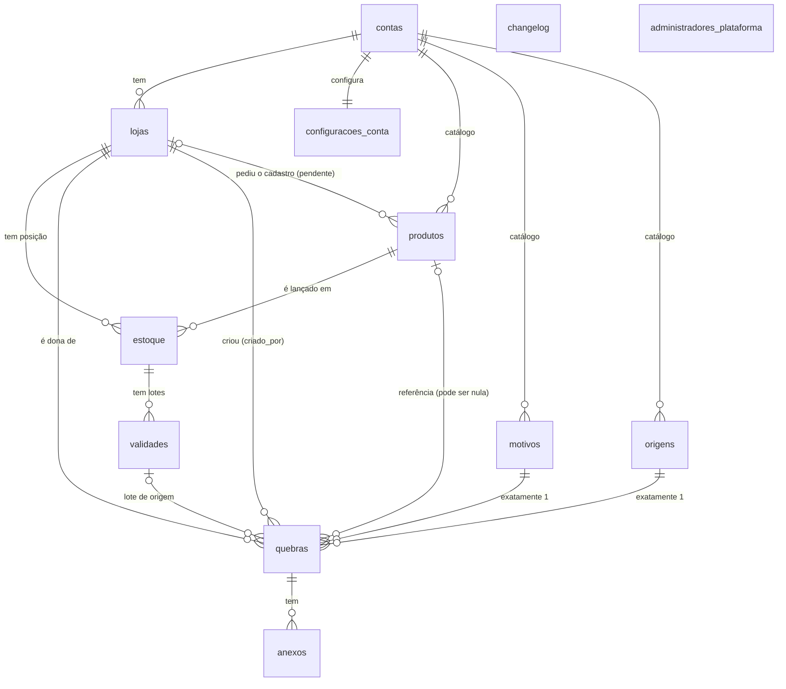

# Modelo de dados

Banco: PostgreSQL (Neon). Fonte da verdade: `backend/migrations/`. O diagrama
editável está em [`schema.dbml`](schema.dbml) (cole em <https://dbdiagram.io>).

## Ideia central

O sistema atende **várias empresas** (multi-tenant) e cada empresa tem **várias
lojas**. Três camadas, e cada tabela mora em exatamente uma delas:

| Camada | Pertence a | Tabelas |
|---|---|---|
| Conta (a empresa cliente) | `contas` | `contas`, `lojas`, `configuracoes_conta` |
| Catálogo (compartilhado pela empresa inteira) | `conta_id` | `produtos`, `motivos`, `origens` |
| Operacional (só da loja) | `loja_id` | `estoque`, `validades`, `quebras`, `anexos` |
| Plataforma (sem dono, fora de qualquer conta) | ninguém | `changelog`, `administradores_plataforma` |

**O login é a loja.** Não existe tabela de usuários: e-mail e senha moram em
`lojas`, e quem entra com aquele e-mail *é* aquela loja. O `role` da loja
(`admin` ou `operador`) decide o que ela pode fazer.

## Diagrama

`changelog` e `administradores_plataforma` ficam soltos de propósito: não
pertencem a nenhuma conta. O acesso a elas é por regra, não por chave
estrangeira.

## Tabelas

Legenda: **PK** chave primária · **FK** chave estrangeira · **U** única ·
`*` obrigatória.

### `contas`
A empresa cliente. Tudo o que é de um cliente aponta, direta ou
indiretamente, pra cá.

| Coluna | Tipo | Notas |
|---|---|---|
| `id` | uuid | PK |
| `nome`* | text | |
| `criado_em`* | timestamptz | |

### `lojas`
Uma loja **e** o seu login.

| Coluna | Tipo | Notas |
|---|---|---|
| `id` | uuid | PK |
| `conta_id`* | uuid | FK → `contas` (cascata) |
| `nome`* | text | |
| `email`* | text | **U no sistema inteiro**, não por conta: no login só se digita e-mail e senha, sem dizer de qual empresa é |
| `senha_hash`* | text | bcrypt, custo 12. A senha nunca é guardada |
| `role`* | `loja_role` | `admin` (enxerga e gerencia a conta inteira) ou `operador` (o padrão: só a própria loja) |
| `ativo`* | boolean | Desativar bloqueia o login sem apagar o histórico |
| `criado_em`*, `atualizado_em` | timestamptz | `atualizado_em` mantido por gatilho |

### `configuracoes_conta`
Uma linha por conta (1:1). Limites e plano.

| Coluna | Tipo | Notas |
|---|---|---|
| `conta_id` | uuid | PK e FK → `contas` (cascata) |
| `limite_usuarios`, `limite_armazenamento_mb` | integer | Nulo = sem limite |
| `plano`* | text | Padrão `padrao` |
| `atualizado_em` | timestamptz | Gatilho |

### `produtos` (catálogo da conta)
O cadastro padronizado: identidade do produto, igual pra todas as lojas.

| Coluna | Tipo | Notas |
|---|---|---|
| `id` | uuid | PK |
| `conta_id`* | uuid | FK → `contas` (cascata) |
| `sku`* | text | **U por conta** (`conta_id`, `sku`) |
| `descricao`* | text | Vazia enquanto o produto está pendente |
| `codigo_barras` | text | **U por conta** quando preenchido (índice parcial; vazio e nulo não contam) |
| `pendente_cadastro`* | boolean | Criado sem cadastro completo (SKU desconhecido na importação de estoque ou na quebra). O administrador completa |
| `loja_origem_id` | uuid | FK → `lojas` (ao apagar a loja, vira nulo). De onde veio o pedido de cadastro; só faz sentido enquanto pendente |
| `criado_em`*, `atualizado_em` | timestamptz | Gatilho |

### `estoque` (a posição de uma loja)
A ponte **obrigatória** entre uma loja e um produto do catálogo. É aqui que
vivem saldo e valores, porque são da **loja**, não do produto.

| Coluna | Tipo | Notas |
|---|---|---|
| `id` | uuid | PK |
| `loja_id`* | uuid | FK → `lojas` (cascata) |
| `produto_id`* | uuid | FK → `produtos` (**restrito**: não deixa apagar do catálogo enquanto alguma loja tem estoque dele) |
| `saldo`*, `saidas`* | integer | `>= 0` |
| `valor_custo`*, `valor_venda`* | numeric(12,2) | `>= 0` |
| `atualizado_em` | timestamptz | Gatilho |

Única por (`loja_id`, `produto_id`): cada loja tem no máximo **uma** posição
por produto.

### `validades` (lotes)
Nem todo item do estoque tem validade; os que têm ganham uma ou mais linhas.
**Só guarda a data.** Descrição, saldo e valores sempre vêm do `estoque` e do
`produtos` na hora de ler, nunca são copiados, pra não haver duas versões do
mesmo número.

| Coluna | Tipo | Notas |
|---|---|---|
| `id` | uuid | PK |
| `estoque_id`* | uuid | FK → `estoque` (cascata) |
| `data_validade` | date | Nula = sem data cadastrada |
| `criado_em`* | timestamptz | |

### `motivos` e `origens`
Listas de apoio da quebra, por conta (ex.: "vencido", "avariado"; "gôndola",
"depósito"). Mesma forma nas duas.

| Coluna | Tipo | Notas |
|---|---|---|
| `id` | uuid | PK |
| `conta_id`* | uuid | FK → `contas` (cascata) |
| `label`* | text | **U por conta** |
| `embutido`* | boolean | Vem de fábrica (não deve ser apagado pela interface) |
| `criado_em`* | timestamptz | |

### `quebras`
Perda registrada. **Pode não existir** pra um produto, ou existir várias vezes
(direto ou a partir de um lote vencido). Cada quebra tem **exatamente 1 motivo
e exatamente 1 origem**.

| Coluna | Tipo | Notas |
|---|---|---|
| `id` | uuid | PK |
| `loja_id`* | uuid | FK → `lojas` (restrito). A loja dona do registro |
| `produto_id` | uuid | FK → `produtos` (ao apagar, vira nulo). Nulo enquanto o produto ainda não existe no catálogo |
| `sku`, `descricao`, `codigo_barras` | text | O que o operador tinha em mãos quando o produto não está no cadastro |
| `pendente_produto`* | boolean | |
| `data_validade` | date | |
| `quantidade`* | integer | `>= 0` |
| `motivo_id`* | uuid | FK → `motivos` (restrito) |
| `origem_id`* | uuid | FK → `origens` (restrito) |
| `origem_lote_id` | uuid | FK → `validades` (ao apagar o lote, vira nulo). Quando a quebra nasceu de um lote vencido |
| `observacao` | text | |
| `criado_por_id`* | uuid | FK → `lojas` (restrito). Quem registrou; pode diferir de `loja_id` (admin registrando por outra loja) |
| `criado_em`* | timestamptz | |

### `anexos`
Fotos e documentos de uma quebra. O arquivo em si fica fora do banco; aqui só o
caminho.

| Coluna | Tipo | Notas |
|---|---|---|
| `id` | uuid | PK |
| `quebra_id`* | uuid | FK → `quebras` (cascata) |
| `tipo`* | `anexo_tipo` | `foto-produto`, `foto-etiqueta` ou `documento` |
| `nome_arquivo`*, `mime_type`*, `storage_path`* | text | |
| `tamanho_bytes`* | bigint | `>= 0` |
| `criado_em`* | timestamptz | |

### `changelog`
Novidades do sistema, iguais pra todo cliente (sem `conta_id`).

| Coluna | Tipo | Notas |
|---|---|---|
| `id` | uuid | PK |
| `versao`*, `titulo`* | text | |
| `descricao` | text | |
| `restrito_admin`* | boolean | Entrada só pra administradores |
| `texto_generico` | text | O que quem **não** é admin vê no lugar. Obrigatório quando `restrito_admin` é verdadeiro (restrição `check`) |
| `publicado_em`* | timestamptz | |

### `administradores_plataforma`
O time interno (compras, normalização do catálogo). Login separado dos
clientes, sem relação por chave com nenhuma conta.

| Coluna | Tipo | Notas |
|---|---|---|
| `id` | uuid | PK |
| `nome`* | text | |
| `email`* | text | U |
| `senha_hash`* | text | |
| `ativo`* | boolean | |
| `criado_em`* | timestamptz | |

## O que acontece ao apagar (`on delete`)

| Relação | Ao apagar o pai |
|---|---|
| `contas` → `lojas`, `configuracoes_conta`, `produtos`, `motivos`, `origens` | **Cascata**: a conta leva tudo junto |
| `lojas` → `estoque` | Cascata |
| `estoque` → `validades` | Cascata |
| `quebras` → `anexos` | Cascata |
| `produtos` → `estoque` | **Restrito**: produto com estoque em alguma loja não sai do catálogo |
| `lojas` → `quebras` (dona e `criado_por`) | **Restrito**: o histórico de perdas não some junto com a loja |
| `motivos`, `origens` → `quebras` | **Restrito**: não se apaga um motivo em uso |
| `produtos` → `quebras.produto_id` | Vira **nulo** (a quebra guarda sku/descrição próprios) |
| `validades` → `quebras.origem_lote_id` | Vira **nulo** |
| `lojas` → `produtos.loja_origem_id` | Vira **nulo** |

## Segurança

Três credenciais de banco, cada uma com o mínimo que precisa:

| Role | Usada por | Pode |
|---|---|---|
| dona (`neondb_owner`) | só migrations e manutenção, nunca o app | Tudo. **Ignora a RLS** (dono sempre ignora) |
| `app_runtime` | o back-end, em toda requisição de usuário logado | Ler/gravar, **sempre sob RLS** |
| `app_auth` | só o login | Apenas `SELECT` em `lojas` e `administradores_plataforma` |

**Row Level Security** está ligada e forçada (`force`) em todas as tabelas. A
cada requisição o back-end declara ao banco quem está chamando
(`app.conta_id`, `app.loja_id`, `app.role`) e as políticas fazem o filtro:
um erro numa rota não consegue vazar dados de outra conta.

| Tabela | Ler | Escrever |
|---|---|---|
| `contas` | a própria | admin edita a própria |
| `lojas` | todas da própria conta | admin cria/exclui; cada loja edita a si; admin edita qualquer uma da conta |
| `configuracoes_conta` | a da própria conta | admin |
| `produtos` | da própria conta | **admin** cria, edita e exclui. **Operador** só cria produto **pendente** (`pendente_cadastro = true`) e **com a própria loja como origem** |
| `motivos`, `origens` | da própria conta | qualquer login da conta |
| `estoque`, `validades`, `quebras`, `anexos` | operador: só a própria loja · admin: todas as lojas da conta | idem |
| `changelog` | todos (a troca por `texto_generico` é feita pelo back-end) | só a plataforma |
| `administradores_plataforma` | só `app_auth` (login) | ninguém pelo app |

O e-mail de login é único no sistema todo e o login busca por e-mail **antes**
de saber a conta, por isso essa consulta usa a role `app_auth` à parte. Ela é
a única exceção ao filtro por conta e só lê duas tabelas.

## Índices (além das chaves primárias)

| Tabela | Índice | Pra quê |
|---|---|---|
| `lojas` | `email` único | login |
| `produtos` | (`conta_id`, `sku`) único | SKU não repete na conta |
| `produtos` | (`conta_id`, `codigo_barras`) único parcial | código de barras não repete; vazio e nulo ficam de fora |
| `produtos` | `descricao` GIN trigram | busca por pedaço do nome (`ILIKE '%termo%'`) sem varrer a tabela |
| `produtos` | (`conta_id`) parcial onde `pendente_cadastro` | a fila do administrador, pequena e sempre filtrada assim |
| `estoque` | (`loja_id`, `produto_id`) único | uma posição por loja e produto |
| `validades` | (`estoque_id`, `data_validade`) | a tela de validades ordena por urgência |
| `quebras` | (`loja_id`, `criado_em` desc) | listagem padrão da tela de quebra |
| `quebras` | `produto_id`, `motivo_id`, `origem_id`, `criado_por_id` | junções e filtros |
| `anexos` | `quebra_id` | anexos de uma quebra |
| `motivos`, `origens` | (`conta_id`, `label`) único | rótulo não repete na conta |

## Estado da implementação

O banco tem o modelo inteiro. O back-end (`backend/src/rotas/`) ainda não
expõe todas as tabelas:

| Já tem rotas | Ainda só no banco |
|---|---|
| `contas`/`lojas` (login), `produtos`, `estoque` | `validades`, `quebras`, `anexos`, `motivos`, `origens`, `configuracoes_conta`, `changelog`, `administradores_plataforma` |

As telas de Validades e Quebra ainda usam dados em memória; migrar cada uma é
mexer só no `api.ts` da feature (ver `CLAUDE.md`).

## Como reconstruir o banco do zero

Rodar, na ordem, como a role dona:

1. `backend/migrations/1700000000000_schema.sql`: tabelas, tipos, índices, gatilhos
2. `backend/migrations/1700000000001_rls.sql`: roles, funções e políticas de RLS
3. `backend/migrations/1700000000002_produtos_pendente_pelo_operador.sql`: política do operador pra produto pendente

Depois, definir a senha das roles `app_runtime` e `app_auth` (nunca em arquivo
versionado) e criar a primeira conta e a primeira loja `admin`.
