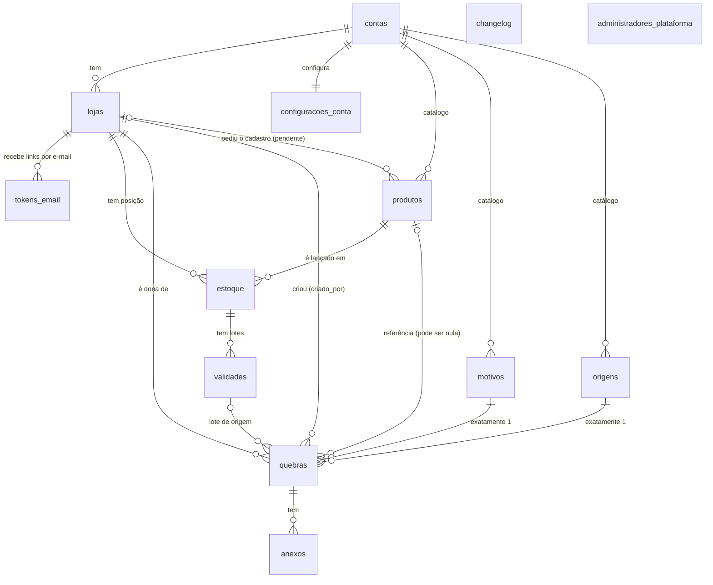

# Modelo de dados

Banco: PostgreSQL (Neon). Fonte da verdade: `backend/migrations/`. O diagrama
editável está em [`schema.dbml`](schema.dbml) (cole em <https://dbdiagram.io>).

## Ideia central

O sistema atende **várias empresas** (multi-tenant) e cada empresa tem **várias
lojas**. Três camadas, e cada tabela mora em exatamente uma delas:

| Camada | Pertence a | Tabelas |
|---|---|---|
| Conta (a empresa cliente) | `contas` | `contas`, `lojas`, `configuracoes_conta`, `tokens_email` |
| Catálogo (compartilhado pela empresa inteira) | `conta_id` | `produtos`, `motivos`, `origens` |
| Operacional (só da loja) | `loja_id` | `estoque`, `validades`, `quebras`, `anexos` |
| Plataforma (sem dono, fora de qualquer conta) | ninguém | `changelog`, `administradores_plataforma` |

**O login é a loja.** Não existe tabela de usuários: e-mail e senha moram em
`lojas`, e quem entra com aquele e-mail *é* aquela loja. O `role` da loja
(`admin` ou `operador`) decide o que ela pode fazer.

## Diagrama

`changelog` e `administradores_plataforma` ficam soltos de propósito: não
pertencem a nenhuma conta. O acesso a elas é por regra, não por chave
estrangeira.

## Tabelas

Legenda: **PK** chave primária · **FK** chave estrangeira · **U** única ·
`*` obrigatória.

### `contas`
A empresa cliente. Tudo o que é de um cliente aponta, direta ou
indiretamente, pra cá.

| Coluna | Tipo | Notas |
|---|---|---|
| `id` | uuid | PK |
| `nome`* | text | |
| `criado_em`* | timestamptz | |

### `lojas`
Uma loja **e** o seu login.

| Coluna | Tipo | Notas |
|---|---|---|
| `id` | uuid | PK |
| `conta_id`* | uuid | FK → `contas` (cascata) |
| `nome`* | text | |
| `email`* | text | **U no sistema inteiro**, não por conta: no login só se digita e-mail e senha, sem dizer de qual empresa é |
| `senha_hash`* | text | bcrypt, custo 12. A senha nunca é guardada |
| `role`* | `loja_role` | `admin` (enxerga e gerencia a conta inteira) ou `operador` (o padrão: só a própria loja). **Fixo depois de criado** (ver "Segurança"): trocar o papel de alguém é desativar o login e criar outro |
| `ativo`* | boolean | Desativar bloqueia o login sem apagar o histórico |
| `email_confirmado_em` | timestamptz | Nulo = e-mail ainda não confirmado, e o login é recusado. Conta nova nasce nula; quem existia antes do cadastro público foi preenchido na migration |
| `senha_alterada_em`* | timestamptz | Quando a senha mudou pela última vez. Refresh token emitido antes disso deixa de valer: trocar a senha encerra as outras sessões |
| `periodo_saidas_dias` | integer | Período do relatório de saídas **deste login**, em dias (1 a 3650; `check`). Nulo = nunca definido, e a tela usa 390. Sustenta a previsão de validades (ver `docs/dominio.md`); cada login edita o seu |
| `criado_em`*, `atualizado_em` | timestamptz | `atualizado_em` mantido por gatilho |

### `configuracoes_conta`
Uma linha por conta (1:1). Limites e plano.

| Coluna | Tipo | Notas |
|---|---|---|
| `conta_id` | uuid | PK e FK → `contas` (cascata) |
| `limite_usuarios`, `limite_armazenamento_mb`, `limite_registros` | integer | Nulo = sem limite. `limite_armazenamento_mb` é o teto da soma dos anexos; `limite_registros`, o de produtos + linhas de estoque + lotes + quebras da conta toda. Contas **novas** nascem com 1.024 MB e 250.000 registros; as que já existiam seguem sem limite até alguém definir (ver "Limites de uso") |
| `plano`* | text | Padrão `padrao` |
| `atualizado_em` | timestamptz | Gatilho |

### `tokens_email`
Links de uso único enviados por e-mail (confirmar e-mail, redefinir senha).
Guarda só o **hash** do token: quem lesse a tabela veria hashes, que não servem
de link.

| Coluna | Tipo | Notas |
|---|---|---|
| `id` | uuid | PK |
| `loja_id`* | uuid | FK → `lojas` (cascata) |
| `tipo`* | `token_email_tipo` | `confirmar-email` (vale 24 h) ou `redefinir-senha` (vale 1 h) |
| `token_hash`* | text | **U**. SHA-256 do token que foi no link |
| `expira_em`* | timestamptz | |
| `usado_em` | timestamptz | Preenchido ao usar: token de uso único, nunca volta a valer |
| `criado_em`* | timestamptz | Pedidos repetidos em menos de 1 minuto são ignorados |

Nem `app_runtime` nem `app_auth` leem esta tabela: só as funções de cadastro
(ver "Segurança").

### `produtos` (catálogo da conta)
O cadastro padronizado: identidade do produto, igual pra todas as lojas.

| Coluna | Tipo | Notas |
|---|---|---|
| `id` | uuid | PK |
| `conta_id`* | uuid | FK → `contas` (cascata) |
| `sku`* | text | **U por conta** (`conta_id`, `sku`) |
| `descricao`* | text | Vazia enquanto o produto está pendente |
| `codigo_barras` | text | **U por conta** quando preenchido (índice parcial; vazio e nulo não contam) |
| `pendente_cadastro`* | boolean | Criado sem cadastro completo (SKU desconhecido na importação de estoque ou na quebra). O administrador completa |
| `loja_origem_id` | uuid | FK → `lojas` (ao apagar a loja, vira nulo). De onde veio o pedido de cadastro; só faz sentido enquanto pendente |
| `criado_em`*, `atualizado_em` | timestamptz | Gatilho |

### `estoque` (a posição de uma loja)
A ponte **obrigatória** entre uma loja e um produto do catálogo. É aqui que
vivem saldo e valores, porque são da **loja**, não do produto.

| Coluna | Tipo | Notas |
|---|---|---|
| `id` | uuid | PK |
| `loja_id`* | uuid | FK → `lojas` (cascata) |
| `produto_id`* | uuid | FK → `produtos` (**restrito**: não deixa apagar do catálogo enquanto alguma loja tem estoque dele) |
| `saldo`*, `saidas`* | integer | `>= 0` |
| `valor_custo`*, `valor_venda`* | numeric(12,2) | `>= 0` |
| `atualizado_em` | timestamptz | Gatilho |

Única por (`loja_id`, `produto_id`): cada loja tem no máximo **uma** posição
por produto.

### `validades` (lotes)
Nem todo item do estoque tem validade; os que têm ganham uma ou mais linhas.
**Só guarda a data.** Descrição, saldo e valores sempre vêm do `estoque` e do
`produtos` na hora de ler, nunca são copiados, pra não haver duas versões do
mesmo número.

| Coluna | Tipo | Notas |
|---|---|---|
| `id` | uuid | PK |
| `estoque_id`* | uuid | FK → `estoque` (cascata) |
| `data_validade` | date | Nula = sem data cadastrada |
| `criado_em`* | timestamptz | |

### `motivos` e `origens`
Listas de apoio da quebra, por conta (ex.: "vencido", "avariado"; "gôndola",
"depósito"). Mesma forma nas duas.

| Coluna | Tipo | Notas |
|---|---|---|
| `id` | uuid | PK |
| `conta_id`* | uuid | FK → `contas` (cascata) |
| `label`* | text | **U por conta** |
| `embutido`* | boolean | Vem de fábrica (não deve ser apagado pela interface) |
| `criado_em`* | timestamptz | |

### `quebras`
Perda registrada. **Pode não existir** pra um produto, ou existir várias vezes
(direto ou a partir de um lote vencido). Cada quebra tem **exatamente 1 motivo
e exatamente 1 origem**.

| Coluna | Tipo | Notas |
|---|---|---|
| `id` | uuid | PK |
| `loja_id`* | uuid | FK → `lojas` (restrito). A loja dona do registro |
| `produto_id` | uuid | FK → `produtos` (ao apagar, vira nulo). Nulo enquanto o produto ainda não existe no catálogo |
| `sku`, `descricao`, `codigo_barras` | text | O que o operador tinha em mãos quando o produto não está no cadastro |
| `pendente_produto`* | boolean | |
| `data_validade` | date | |
| `quantidade`* | integer | `>= 0` |
| `motivo_id`* | uuid | FK → `motivos` (restrito) |
| `origem_id`* | uuid | FK → `origens` (restrito) |
| `origem_lote_id` | uuid | FK → `validades` (ao apagar o lote, vira nulo). Quando a quebra nasceu de um lote vencido |
| `observacao` | text | |
| `criado_por_id`* | uuid | FK → `lojas` (restrito). Quem registrou; pode diferir de `loja_id` (admin registrando por outra loja) |
| `criado_em`* | timestamptz | |

### `anexos`
Fotos e documentos de uma quebra. O arquivo em si fica fora do banco (no bucket);
aqui só o caminho, que é SEMPRE `conta/registro/anexo` — derivado dos ids, nunca
informado pelo cliente (assim o "desfazer" da exclusão não pode apontar para o
arquivo de outra loja). Um espaço por tipo em cada registro.

| Coluna | Tipo | Notas |
|---|---|---|
| `id` | uuid | PK |
| `quebra_id`* | uuid | FK → `quebras` (cascata) |
| `tipo`* | `anexo_tipo` | `foto-produto`, `foto-etiqueta` ou `documento` |
| `nome_arquivo`*, `mime_type`*, `storage_path`* | text | |
| `tamanho_bytes`* | bigint | `>= 0` |
| `criado_em`* | timestamptz | |

### `changelog`
Novidades do sistema, iguais pra todo cliente (sem `conta_id`).

| Coluna | Tipo | Notas |
|---|---|---|
| `id` | uuid | PK |
| `versao`*, `titulo`* | text | |
| `descricao` | text | |
| `restrito_admin`* | boolean | Entrada só pra administradores |
| `texto_generico` | text | O que quem **não** é admin vê no lugar. Obrigatório quando `restrito_admin` é verdadeiro (restrição `check`) |
| `publicado_em`* | timestamptz | |

### `administradores_plataforma`
O time interno (compras, normalização do catálogo). Login separado dos
clientes, sem relação por chave com nenhuma conta.

| Coluna | Tipo | Notas |
|---|---|---|
| `id` | uuid | PK |
| `nome`* | text | |
| `email`* | text | U |
| `senha_hash`* | text | |
| `ativo`* | boolean | |
| `criado_em`* | timestamptz | |

## O que acontece ao apagar (`on delete`)

| Relação | Ao apagar o pai |
|---|---|
| `contas` → `lojas`, `configuracoes_conta`, `produtos`, `motivos`, `origens` | **Cascata**: a conta leva tudo junto |
| `lojas` → `estoque`, `tokens_email` | Cascata |
| `estoque` → `validades` | Cascata |
| `quebras` → `anexos` | Cascata |
| `produtos` → `estoque` | **Restrito**: produto com estoque em alguma loja não sai do catálogo |
| `lojas` → `quebras` (dona e `criado_por`) | **Restrito**: o histórico de perdas não some junto com a loja |
| `motivos`, `origens` → `quebras` | **Restrito**: não se apaga um motivo em uso |
| `produtos` → `quebras.produto_id` | Vira **nulo** (a quebra guarda sku/descrição próprios) |
| `validades` → `quebras.origem_lote_id` | Vira **nulo** |
| `lojas` → `produtos.loja_origem_id` | Vira **nulo** |

## Segurança

Três credenciais de banco, cada uma com o mínimo que precisa:

| Role | Usada por | Pode |
|---|---|---|
| dona (`neondb_owner`) | só migrations e manutenção, nunca o app | Tudo. **Ignora a RLS** (dono sempre ignora) |
| `app_runtime` | o back-end, em toda requisição de usuário logado | Ler/gravar, **sempre sob RLS** |
| `app_auth` | login, cadastro e recuperação de senha | `SELECT` em `lojas` e `administradores_plataforma` e **executar quatro funções** (abaixo). Nenhum privilégio de escrita em tabela |
| `app_definer` | ninguém (`NOLOGIN`) | É só a dona das funções (as quatro de cadastro e as de limite). Escreve em `contas`, `lojas`, `configuracoes_conta`, `motivos`, `origens` e `tokens_email`; só **lê** `produtos`, `estoque`, `validades`, `quebras` e `anexos` (para contar o uso da conta); não pode criar objetos |

**Row Level Security** está ligada e forçada (`force`) em todas as tabelas. A
cada requisição o back-end declara ao banco quem está chamando
(`app.conta_id`, `app.loja_id`, `app.role`) e as políticas fazem o filtro:
um erro numa rota não consegue vazar dados de outra conta.

| Tabela | Ler | Escrever |
|---|---|---|
| `contas` | a própria | admin edita a própria |
| `lojas` | todas da própria conta | admin cria/exclui; cada loja edita a si; admin edita qualquer uma da conta. **Só as colunas `nome`, `ativo`, `senha_hash`, `senha_alterada_em` e `periodo_saidas_dias`** (privilégio por coluna, migrations 0004 e 0005) |
| `configuracoes_conta` | a da própria conta | admin |
| `produtos` | da própria conta | **admin** cria, edita e exclui. **Operador** só cria produto **pendente** (`pendente_cadastro = true`) e **com a própria loja como origem** |
| `motivos`, `origens` | da própria conta | qualquer login da conta |
| `estoque`, `validades`, `quebras`, `anexos` | operador: só a própria loja · admin: todas as lojas da conta | idem |
| `changelog` | todos (a troca por `texto_generico` é feita pelo back-end) | só a plataforma |
| `administradores_plataforma` | só `app_auth` (login) | ninguém pelo app |
| `tokens_email` | ninguém pelo app | só as funções de cadastro |

**Como a API expõe isso.** As rotas de leitura de `estoque`, `validades` e
`quebras` aceitam `?loja=`: ausente = a loja do login (o padrão de sempre);
`todas` = sem filtro de loja; `<uuid>` = aquela loja. O parâmetro só escolhe o
recorte — **quem decide o que cada perfil enxerga é a RLS**, então um operador que
peça `todas` continua vendo só a própria loja. As escritas aceitam `?loja=<id>` só
para o administrador (o operador recebe 403). Não houve mudança de schema.

**Privilégio por coluna em `lojas`.** A política de RLS enxerga linhas, não
colunas: sem mais nada, um operador que conseguisse rodar um `UPDATE` na própria
linha (por uma injeção de SQL numa rota, por exemplo) poderia trocar o próprio
`role` para `admin`. Por isso `app_runtime` só tem `UPDATE` em `nome`, `ativo`,
`senha_hash`, `senha_alterada_em` e `periodo_saidas_dias`; `role`, `email` e `conta_id` não mudam depois
de criados. Criar um login continua sendo um `INSERT`, que a política só deixa o
admin fazer.

O e-mail de login é único no sistema todo e o login busca por e-mail **antes**
de saber a conta, por isso essa consulta usa a role `app_auth` à parte. Ela é
a única exceção ao filtro por conta e só lê duas tabelas.

### Funções de cadastro e recuperação de senha

Criar conta e trocar senha por link são as operações mais sensíveis, então
não são consultas soltas: são funções do banco (`SECURITY DEFINER`, com
`search_path` fixo) que o login apenas **executa**. As que mudam algo exigem o
token **dentro** da função, então mesmo que a credencial do login vazasse, ela
só conseguiria o que um token válido permite.

| Função | O que faz |
|---|---|
| `criar_conta(empresa, loja, e-mail, hash)` | Cria conta, loja administradora, configurações e os motivos/origens padrão, tudo ou nada. Devolve `NULL` se o e-mail já existe (a rota responde igual nos dois casos) |
| `solicitar_token(e-mail, tipo, hash, validade)` | Registra o token e devolve pra quem enviar. Não devolve nada, e não diz por quê, se o e-mail não existe, a conta está desativada, já foi confirmada ou houve pedido há menos de 1 minuto |
| `confirmar_email_com_token(hash)` | Consome o token (uma vez só, atomicamente) e confirma o e-mail |
| `redefinir_senha_com_token(hash, senha_hash)` | Consome o token e troca a senha, encerra as outras sessões e invalida os demais links da loja. Receber o link também confirma o e-mail |

### Limites de uso: registros e arquivos

O teto é da **conta**, não da loja, e é aplicado por **gatilhos no banco**
(`AFTER INSERT`, um por comando, não por linha) em `produtos`, `estoque`,
`validades`, `quebras` e `anexos`. Estar no banco, e não nas rotas, faz valer
para qualquer caminho que insira — cadastro, importação, "desfazer" — inclusive os
que ainda não existem. O gatilho recusa com o erro `53400`
(`configuration_limit_exceeded`) quando o comando **inseriu algo** e o total
passou do limite; o servidor traduz para HTTP 409 (`limite_registros` ou
`limite_armazenamento`).

- **Só inserir é barrado.** Editar e excluir passam sempre: quem está no teto
  precisa poder limpar. Um `on conflict do nothing` que não inseriu nada também passa.
- **Sem sessão de usuário não há limite** (`app.conta_id` vazio): migração e
  restauração de backup não são barradas.
- **A contagem é da conta inteira.** O RLS mostra ao operador só a loja dele, então a
  soma roda em `calcular_uso(conta)`, `SECURITY DEFINER` da `app_definer` (que ganhou
  `SELECT` e uma política de leitura nessas tabelas). Ela recebe a conta como
  argumento e por isso **não é exposta**: o que o `app_runtime` executa é
  `uso_da_conta()`, sem argumento, que usa a conta da sessão.
- **Uma trava por conta** (`pg_advisory_xact_lock`) segura a conferência: dois
  comandos simultâneos não passam juntos do limite.
- Troca de anexo do mesmo tipo (apaga o antigo, insere o novo na mesma transação) conta
  só o novo.

## Índices (além das chaves primárias)

| Tabela | Índice | Pra quê |
|---|---|---|
| `lojas` | `email` único | login |
| `produtos` | (`conta_id`, `sku`) único | SKU não repete na conta |
| `produtos` | (`conta_id`, `codigo_barras`) único parcial | código de barras não repete; vazio e nulo ficam de fora |
| `produtos` | `descricao` GIN trigram | busca por pedaço do nome (`ILIKE '%termo%'`) sem varrer a tabela |
| `produtos` | (`conta_id`) parcial onde `pendente_cadastro` | a fila do administrador, pequena e sempre filtrada assim |
| `tokens_email` | (`loja_id`, `tipo`) parcial onde `usado_em` é nulo | achar o link pendente de uma loja |
| `estoque` | (`loja_id`, `produto_id`) único | uma posição por loja e produto |
| `validades` | (`estoque_id`, `data_validade`) | a tela de validades ordena por urgência |
| `quebras` | (`loja_id`, `criado_em` desc) | listagem padrão da tela de quebra |
| `quebras` | `produto_id`, `motivo_id`, `origem_id`, `criado_por_id` | junções e filtros |
| `anexos` | `quebra_id` | anexos de uma quebra |
| `motivos`, `origens` | (`conta_id`, `label`) único | rótulo não repete na conta |

## Estado da implementação

O banco tem o modelo inteiro (13 tabelas). O back-end (`backend/src/rotas/`) ainda não
expõe todas as tabelas:

| Já tem rotas | Ainda só no banco |
|---|---|
| `contas`/`lojas` (login, criar conta, confirmar e-mail, recuperar e trocar senha), `produtos`, `estoque`, `validades`, `quebras`, `motivos`, `origens` | `anexos`, `changelog`, `administradores_plataforma` |

Validades (`/validades`), Quebra (`/quebras`) e as listas de motivo e origem
(`/motivos`, `/origens`) já gravam no banco. Não há base de exemplo: as listas
começam vazias e só mostram o que a loja lançou.

Rotas em lote, para importação e limpeza: `POST /validades/lote` (até 1000 lotes,
ignora os que já existem), `POST /quebras` com motivo e origem **por item** (ou um
par para o pedido inteiro) e `DELETE /estoque` + `GET /estoque/contagem` e, para uma seleção, `DELETE
/estoque/linhas` + `POST /estoque/linhas/contagem` (só admin; apagar o estoque leva
os lotes junto, por `on delete cascade`).

`/conta` (empresa e plano, troca de senha) e `/lojas` (logins da conta, só admin)
leem e escrevem `contas`, `configuracoes_conta` e `lojas`. Plano e limites
(`configuracoes_conta`) **só se lê** pela API: são da plataforma, não do cliente.

Três escolhas de desenho que vale conhecer:

- **Quebra lê o produto do catálogo na hora.** Descrição, SKU e código de barras
  de um produto cadastrado saem de `produtos`; só um produto pendente usa o que
  o operador digitou (`sku`, `descricao`, `codigo_barras` na própria quebra).
- **Motivo e origem obrigatórios também na API.** `POST /quebras` recusa um
  registro sem os dois (400) e, como a criação é uma só instrução SQL, um item
  inválido num envio de centenas desfaz o envio inteiro.
- **Lista vazia de etiquetas se completa sozinha.** Conta anterior à migration
  0003 não tem motivos nem origens; o primeiro `GET /motivos` (ou `/origens`)
  cria os padrão, os mesmos de `criar_conta`.

Os **arquivos** dos anexos moram num bucket compatível com S3 (R2 da Cloudflare),
pelo back-end (`/anexos`); a tabela `anexos` guarda só os dados e o caminho
(`storage_path`). Ver "Anexos" em `docs/dominio.md`.

## Como reconstruir o banco do zero

Rodar, na ordem, como a role dona:

1. `backend/migrations/1700000000000_schema.sql`: tabelas, tipos, índices, gatilhos
2. `backend/migrations/1700000000001_rls.sql`: roles, funções e políticas de RLS
3. `backend/migrations/1700000000002_produtos_pendente_pelo_operador.sql`: política do operador pra produto pendente
4. `backend/migrations/1700000000003_cadastro_e_recuperacao_de_senha.sql`: `tokens_email`, colunas novas em `lojas`, role `app_definer` e as quatro funções
5. `backend/migrations/1700000000004_lojas_so_altera_colunas_seguras.sql`: `app_runtime` só atualiza `nome`, `ativo`, `senha_hash` e `senha_alterada_em` em `lojas`
6. `backend/migrations/1700000000005_periodo_saidas_por_login.sql`: coluna `lojas.periodo_saidas_dias` (nula = padrão) e o `UPDATE` nela para `app_runtime`
7. `backend/migrations/1700000000006_limites_de_registros_e_arquivos.sql`: `configuracoes_conta.limite_registros`, padrões das contas novas, `calcular_uso`/`uso_da_conta` e os gatilhos de limite

Depois, definir a senha das roles `app_runtime` e `app_auth` (nunca em arquivo
versionado) e criar a primeira conta e a primeira loja `admin`.
